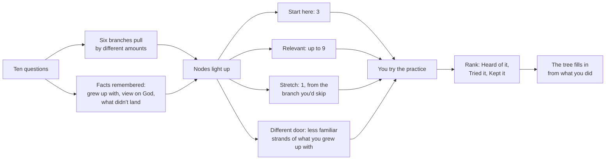

# Skill tree sketches

An exploration of one idea: ten multiple choice questions, then a game-style skill tree whose branches highlight the frameworks, ideas and practices most likely to be useful to that person. Before building it properly, this folder sketches several ways the same tree could be displayed, so a direction can be chosen.

Open `index.html` (built by `node build.js`). Answer the questions or keep the example answers, then switch between displays.

## The map

Two separate things are shown on every node, on purpose:

- **Highlight** is what the questions suggest. It changes whenever the answers change.
- **Rank** is what the person actually did. Only the person can move it.

That split keeps the game feel (a tree that lights up and fills in) without letting a quiz stand in for experience.

## The content

Six branches. Each is a question people live with, not a religion, so every tradition shows up in several branches.

| Branch | The question | Ways in (depth I) | Going further (II) | The deep end (III) |
|---|---|---|---|---|
| Stillness and attention | How do I get quiet enough to notice what is actually here? | Breath attention, Prayer of the heart | Just sitting (zazen), The examen, Remembrance (dhikr), Waiting in silence | Sabbath, Sitting and forgetting |
| Letting go and flow | How do I stop gripping what I cannot control? | Wu wei, What is up to us | Action without grasping, Impermanence, Trust (tawakkul) | All shall be well, The useless tree, Wabi-sabi |
| Character and practice | How do I become, day by day, the person I mean to be? | Evening review, Soul-traits (middot) | Accounting of the soul, Ritual practice (li), A rule of life, The mean | Right speech, The greater struggle |
| Love and other people | What do I owe the people around me, and how do I give it? | Ubuntu, Humaneness (ren) | Loving-kindness (metta), Repairing the world, Standing with the poor, Giving (sadaqah) | Sending and taking, The Honorable Harvest |
| Meaning and making | What is my life for, and who gets to decide? | The will to meaning, Freedom and responsibility | The absurd and revolt, Your own path (svadharma), The leap | Let your life speak, Ikigai (the small kind), Meaning made together |
| Wonder and mystery | How do I live alongside what is bigger than me? | The pale blue dot, The view from above | Beginner's mind, The butterfly dream, Radical amazement, The reed flute | The cloud of unknowing, Mono no aware, God or Nature |

49 nodes from 15 traditions and thinkers. Ten **echoes** link nodes that say similar things in different traditions, for example *not forcing what you cannot control* (wu wei, Epictetus, the Gita, tawakkul, Julian of Norwich) and *looking back over the day* (Seneca, the examen, Mussar's accounting of the soul, Zengzi in the Analects). For someone who found one tradition flat, these links are often the most useful part: the idea that landed in Daoism may already exist, in other words, in the tradition they grew up with.

## How the highlighting works

All of it is in `data.js`, readable and deterministic.

- Each answer adds weight to one or more branches. Each branch is measured against the most it could have received, so branches with more feeding options don't win by default.
- Some answers adjust specific nodes: practices for people who learn by doing, communal practices for people who work things out in groups, a strong lift for less familiar strands of the tradition someone grew up with, and a drop (never removal) for nodes that assume God when someone says they would rather leave God out.
- Start here: the three strongest ways in. Relevant: up to nine more above a threshold. Stretch: one way in from the weakest branch. Across random answer sets, 8 to 13 of 49 nodes light up.
- Every highlight carries the reasons that caused it, shown in the detail panel.

## Displays

Each display is a separate file in `views/`, registered into the shared page. See the page itself for each one's own notes on what works and what is hard.

## Files

- `data.js`: branches, nodes, echoes, questions, scoring.
- `texts.js`: the detail text for each node.
- `shell.html`: the page, the shared detail panel, and the plain list view.
- `views/`: one display per file.
- `build.js`: builds `index.html`. `smoke.js`: a quick browser check for one display.
